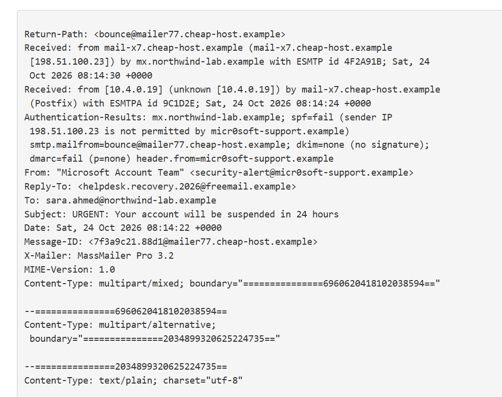
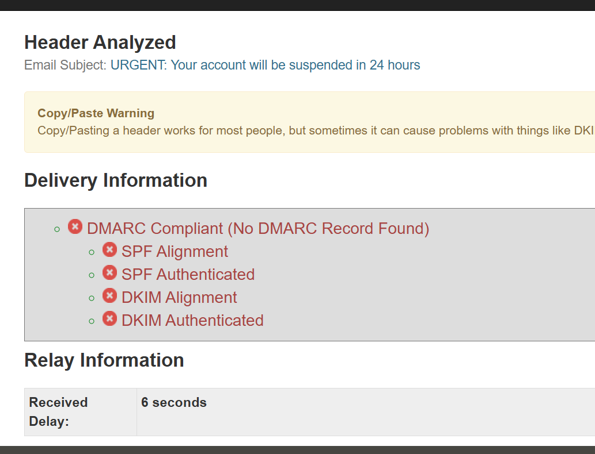
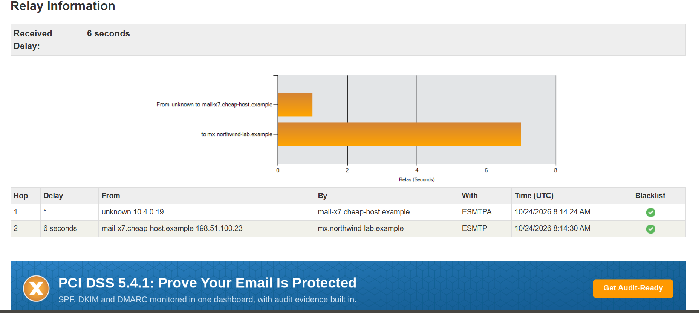
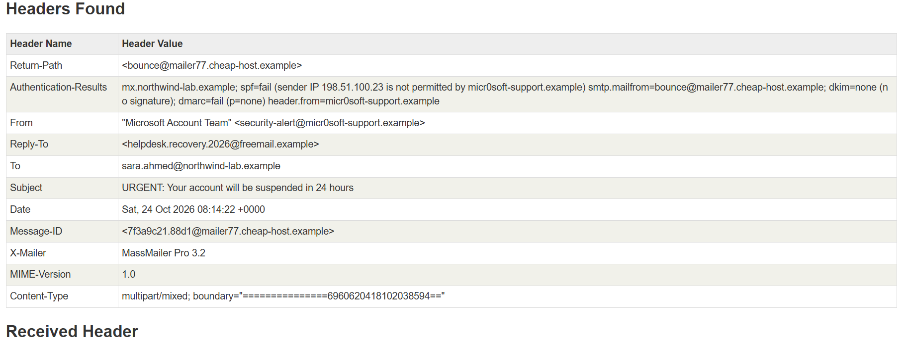
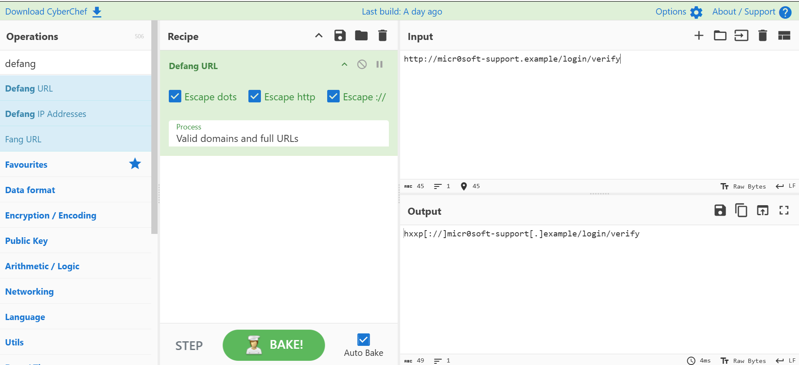
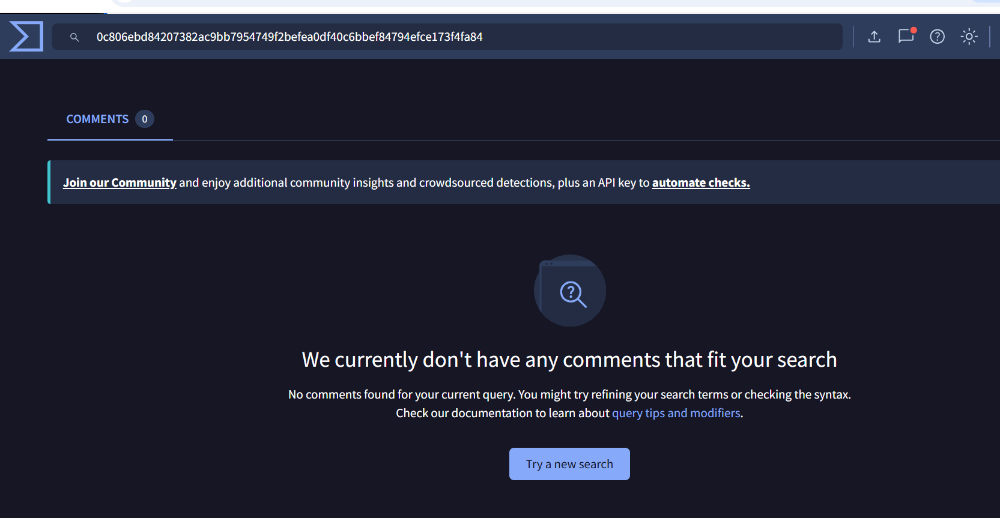

# Phishing Email Analysis

A SOC Level 1 practice project: analyzing a reported phishing email using email headers, hashes, and free tools.

> **Note:** The email is **simulated** and made for practice. The domains end in `.example`, so they are not real sites, and the attachment is harmless.

## Interview Summary

- **What:** Analyzed a reported "account suspended" email, as a SOC L1 analyst would.
- **Found:** A lookalike domain (`micr0soft-support`), SPF fail, no DKIM, DMARC fail, a Reply-To mismatch, a fake link, and a `.pdf.html` double-extension attachment.
- **Tools:** Raw headers, Python (SHA-256 hash), MXToolbox, CyberChef, VirusTotal.
- **Verdict:** Phishing, medium severity, with 8 IOCs listed and defanged.
- **Mapped to MITRE ATT&CK:** T1566.001, T1566.002, T1036.007, T1583.001, T1204.

## How I Analyzed It

**1. Read the raw headers safely** (in a text editor, never by opening the email).



**2. Checked SPF, DKIM, and DMARC with MXToolbox.** All three failed.





**3. Got the attachment hash without opening the file.**
```python
import email, hashlib
from email import policy
m = email.message_from_binary_file(open('phishing_sample.eml','rb'), policy=policy.default)
for p in m.iter_attachments():
    print(p.get_filename(), hashlib.sha256(p.get_payload(decode=True)).hexdigest())
```

**4. Defanged the link** with CyberChef, so it is safe to share.



**5. Checked the hash on VirusTotal.** No results. That does not mean the file is safe. It only means no one has reported it before.



## Key Findings

| Finding | Why it matters |
|---|---|
| Domain `micr0soft-support` (zero instead of o) | Lookalike of Microsoft |
| SPF fail, DKIM none, DMARC fail | The sender could not be verified |
| Reply-To is a free mailbox | Replies go to the attacker |
| Link text and real link do not match | Classic phishing trick |
| `Invoice_8841.pdf.html` | Double extension, HTML attachment |
| "URGENT", "suspended in 24 hours" | Pressure to act fast |

## Full Report

The full analysis, IOC table, MITRE mapping, and recommended actions are in [phishing_analysis_report.md](phishing_analysis_report.md).

## Files

- `phishing_sample.eml`: the simulated email (open it in a text editor only)
- `phishing_analysis_report.md`: the full report
- `screenshots/`: evidence from each step

## Limits and Next Steps

- The email is simulated, so the links were not live and the attachment was not run.
- Next, I want to run a real attachment in a sandbox such as ANY.RUN.
- Next, I want to write a SIEM search that finds users who visited the phishing domain.
